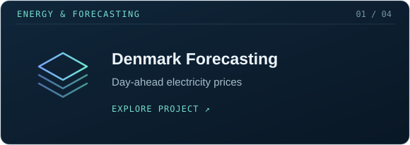
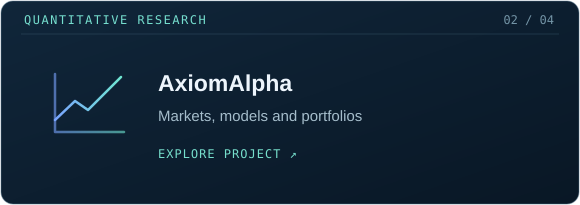
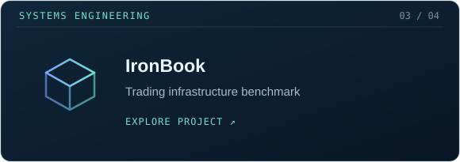
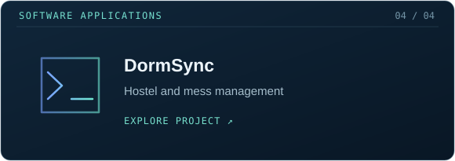

 

**Research &nbsp;·&nbsp; Mathematics &nbsp;·&nbsp; AI &nbsp;·&nbsp; Cloud &nbsp;·&nbsp; Software**

Exploring ideas across disciplines and building things along the way.

  

---

### `// 01 — about`

Hi, I'm **Kartik**. I enjoy working across research, mathematics and software—from forecasting in energy systems to quantitative models, cloud infrastructure and applications.

I'm interested in understanding how things work, testing ideas carefully and building useful systems. I'm open to learning and collaborating across fields.

### `// 02 — selected research`

**[KAT-PatchTST: Physics-Informed Forecasting with Kirchhoff Conservation ↗](https://ieeexplore.ieee.org/abstract/document/11749997)** 
*IEEE Conference Publication · Co-authored research*

A physics-informed approach to power-system forecasting that brings Kirchhoff conservation into a transformer-based model.

### `// 03 — selected projects`

### `// 04 — areas of interest`

`Physics-informed ML` &nbsp; `Time-series forecasting` &nbsp; `Applied mathematics` 
`Quantitative finance` &nbsp; `Cloud & infrastructure` &nbsp; `Software systems`

### `// 05 — tools & technologies`

### `// 06 — connect`

[**Email**](mailto:kartik742m@gmail.com) &nbsp; / &nbsp; [**GitHub**](https://github.com/KartikMehra22)

---

Research, mathematics and computing — always open to new ideas.

