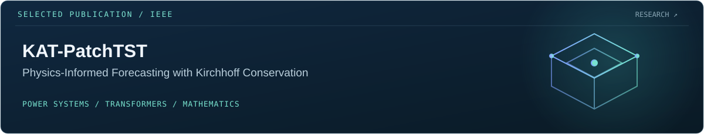

<h1>Kartik Mehra</h1>

**Researcher &nbsp;|&nbsp; Machine Learning &nbsp;|&nbsp; Applied Mathematics &nbsp;|&nbsp; Quantitative Systems**

Exploring ideas across research, mathematics, machine learning, and software engineering. 
Interested in understanding complex systems, testing ideas rigorously, and building useful technology.

[GitHub](https://github.com/KartikMehra22) &nbsp;·&nbsp; [LinkedIn](https://www.linkedin.com/in/kartik-mehra-626631323/) &nbsp;·&nbsp; [Email](mailto:kartik742m@gmail.com)

 

---

### `// 01 — about`

I work across machine learning, mathematical modelling and software engineering. My interests include electricity forecasting, quantitative research and the infrastructure needed to turn ideas into reliable systems.

### `// 02 — selected research`

**[KAT-PatchTST: Physics-Informed Forecasting with Kirchhoff Conservation ↗](https://ieeexplore.ieee.org/abstract/document/11749997)** 
*IEEE PES APPEEC 2026 · Co-authored publication and presentation*

A physics-informed forecasting approach integrating Kirchhoff conservation into a transformer-based time-series architecture.

`Power systems` &nbsp; `Machine learning` &nbsp; `Time-series forecasting` &nbsp; `Applied mathematics`

### `// 03 — selected projects`

<table>
<tr>
<td></td>
<td><strong><a href="https://github.com/KartikMehra22/Denmark_Forcasting">Denmark Forecasting ↗</a></strong> Energy &amp; forecasting Day-ahead electricity price forecasting for Denmark's DK1 and DK2 bidding zones. Python · Pandas · LightGBM · PatchTST · Chronos</td>
</tr>
<tr>
<td></td>
<td><strong><a href="https://github.com/KartikMehra22/AxiomAlpha">AxiomAlpha ↗</a></strong> Quantitative research Financial market research, alpha signals, statistical models and portfolio optimisation. Python · scikit-learn · XGBoost · LangGraph</td>
</tr>
<tr>
<td></td>
<td><strong><a href="https://github.com/KartikMehra22/IronBook">IronBook ↗</a></strong> Systems engineering A distributed platform for benchmarking trading infrastructure. Go · Kubernetes · Terraform</td>
</tr>
<tr>
<td></td>
<td><strong><a href="https://github.com/KartikMehra22/DormSync-">DormSync ↗</a></strong> Software applications A platform for hostel and mess management. Next.js · Express · PostgreSQL</td>
</tr>
</table>

### `// 04 — experience`

**AAU Energy · Aalborg University** — Remote Research Collaborator 
October 2026 – Present 
Working on Danish electricity price and demand forecasting, time-series analysis and energy data pipelines.

**WorldQuant BRAIN** — Research Consultant 
Quantitative research, alpha signal development, financial time-series analysis and statistical modelling.

### `// 05 — areas of interest`

**Machine learning** &nbsp; `Physics-informed ML` · `Deep learning` · `Forecasting` · `Interpretability` 
**Mathematics** &nbsp; `Applied mathematics` · `Probability & statistics` · `Modelling` · `Optimisation` 
**Quantitative research** &nbsp; `Quantitative finance` · `Financial modelling` · `Statistical research` 
**Emerging technology** &nbsp; `Quantum computing` · `Intelligent systems`

### `// 06 — tools & technologies`

**Languages** &nbsp; `Python` · `Go` · `JavaScript` 
**Machine learning** &nbsp; `PyTorch` · `scikit-learn` · `XGBoost` · `LangChain` · `LangGraph` 
**Infrastructure** &nbsp; `Docker` · `Kubernetes` · `Terraform` 
**Tools** &nbsp; `Git` · `Linux` · `Cloud infrastructure`

### `// 07 — recognition`

- **Energy Shark Tank** — Top 5 team, IEEE PES APPEEC 2026.
- **IEEE PES APPEEC 2026** — Co-authored research publication and presentation.

GitHub's contribution graph and native achievements are available on this profile.

### `// 08 — connect`

[**GitHub**](https://github.com/KartikMehra22) &nbsp; / &nbsp; [**LinkedIn**](https://www.linkedin.com/in/kartik-mehra-626631323/) &nbsp; / &nbsp; [**Email**](mailto:kartik742m@gmail.com)

---

Always open to exploring ideas, research collaborations, and building meaningful things.

