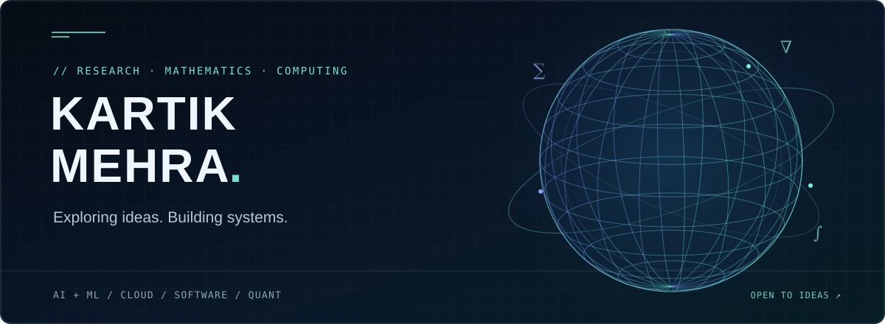
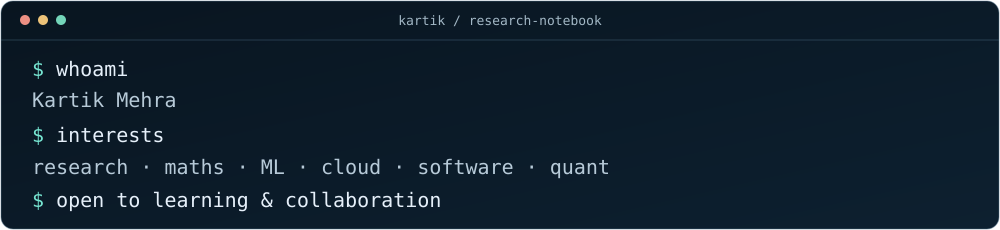

 

**Research &nbsp;·&nbsp; Mathematics &nbsp;·&nbsp; Machine Learning &nbsp;·&nbsp; Cloud &nbsp;·&nbsp; Software**

Exploring ideas across disciplines and building things along the way.

  

---

### `// 01 — about`

Hi, I'm **Kartik**. I enjoy exploring how mathematical ideas, machine learning and software come together—from energy forecasting and quantitative research to cloud infrastructure and applications.

### `// 02 — research`

**[KAT-PatchTST: Physics-Informed Forecasting with Kirchhoff Conservation ↗](https://ieeexplore.ieee.org/abstract/document/11749997)** 
*IEEE PES APPEEC 2026 · Co-authored research*

A physics-informed approach that brings Kirchhoff conservation into transformer-based time-series forecasting.

### `// 03 — projects`

<table>
<tr>
<td></td>
<td><strong><a href="https://github.com/KartikMehra22/Denmark_Forcasting">Denmark Forecasting ↗</a></strong> Day-ahead electricity price forecasting for Denmark's DK1 and DK2 bidding zones. Python · Pandas · LightGBM · PatchTST · Chronos</td>
</tr>
<tr>
<td></td>
<td><strong><a href="https://github.com/KartikMehra22/AxiomAlpha">AxiomAlpha ↗</a></strong> Financial market research, alpha signals, statistical models and portfolio optimisation. Python · scikit-learn · XGBoost · LangGraph</td>
</tr>
<tr>
<td></td>
<td><strong><a href="https://github.com/KartikMehra22/IronBook">IronBook ↗</a></strong> A distributed platform for benchmarking trading infrastructure. Go · Kubernetes · Terraform</td>
</tr>
<tr>
<td></td>
<td><strong><a href="https://github.com/KartikMehra22/DormSync-">DormSync ↗</a></strong> A platform for hostel and mess management. Next.js · Express · PostgreSQL</td>
</tr>
</table>

### `// 04 — tools & tech`

**Languages** 
`Python` · `SQL` · `C++` · `JavaScript` · `TypeScript` · `Bash` · `Go`

**Machine learning & AI** 
`PyTorch` · `LangGraph` · `LangChain` · `scikit-learn` · `XGBoost` · `LightGBM` · `PatchTST` · `Chronos` · `TimeXer` · `RevIN` · `Time-series forecasting` · `Transformers` · `Statistical modelling` · `LLMs` · `RAG`

**Cloud & DevOps** 
`AWS` (ECS, S3, EC2, ALB, ECR) · `Terraform` · `Docker` · `Kubernetes` · `GitHub Actions` · `CI/CD` · `Nginx`

**Web & frameworks** 
`Next.js` · `React` · `Vite` · `Node.js` · `Express.js` · `Prisma ORM` · `Tailwind CSS`

**Data & tools** 
`PostgreSQL` · `MySQL` · `MongoDB` · `SQLite` · `JWT authentication` · `Git` · `Linux` · `Energinet API` · `EIA-930`

---

Research, mathematics and computing — always open to new ideas.

